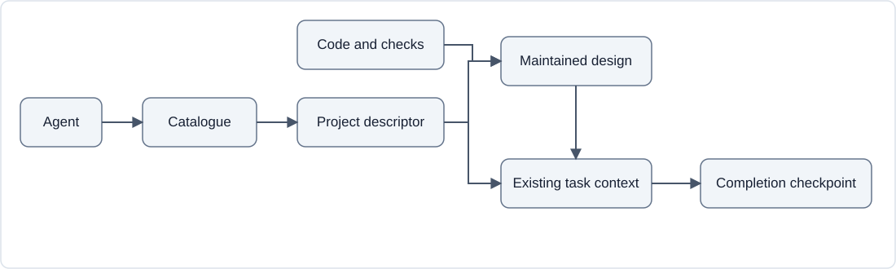
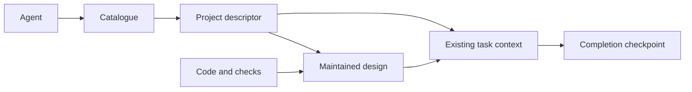

# Vault design

Status: maintained design with implemented core, scoped integration evidence, and recorded user writing preferences. Updated: 11 October 2026.

Present-state evidence is recorded separately in [CURRENT.md](../CURRENT.md). The catalogue, project descriptor, helper, installer, and two skills implement the core design. User-level discovery is configured locally. Completed checks and unverified scopes are recorded independently; optional documents and style refinements remain conventions or proposals until needed and checked.

Confirmed requirements:

- One central docs repository with subfolders accessible to agents working across projects.
- The project and checkout are named Vault. It also holds useful task tools that have no suitable home in another repository.
- Folder descriptions that help agents find relevant context, similar to skill descriptions.
- Readable records of current task context and progress for user audit.
- Skills for producing documents in the user's preferred style.
- Markdown documents with images and diagrams.
- Update appropriate existing documents to reflect new information by default. Create a new document only when explicitly requested or when requested work or an agreed workflow needs a document with no appropriate existing home.

The five reviewed issues are resolved in the document roles and workflow below, with operating rules in [AGENTS.md](../AGENTS.md). The core is now implemented for the user's full setup test. Resolving a design issue or installing a component does not establish untested runtime behaviour.

## Current implementation

Canonical project descriptors live at `projects/<project-id>/PROJECT.md`. The documentation project's descriptor routes to this existing design, the research comparison, and the root current-state record. Existing suitable documents remain at their current paths.

`scripts/docs_repo.py` derives its root from its own location by default, so it works from another workspace. It safely loads YAML frontmatter with PyYAML, validates unique routing identities, generates deterministic `CATALOG.md`, finds candidate projects, and checks supported local document/media links and anchors. `--root PATH` allows isolated fixtures and relocated checkouts. It is a bounded consistency checker, not a complete Markdown parser or proof of implementation correctness. Remote URL and viewer checks are separate.

The canonical `docs-context` and `write-project-doc` skills live under `.agents/skills/`. Their on-demand references cover writing style and task tools. They resolve the central root from local `~/.agents/agent-docs.json`, or their resolved canonical location if configuration is absent. The configuration names and skill names remain stable for compatibility. The instructions apply maintenance rules from other code checkouts and preserve scope, evidence, and historical checkpoints.

On Windows, `scripts/install-local.ps1` adds a bounded managed block to global `~/.codex/AGENTS.md`, writes `docs_root` in `~/.agents/agent-docs.json`, and links user skill directories to the canonical skill folders using junctions. It preserves unrelated settings, is idempotent, and refuses conflicting roots or destinations. Explicit `-PreviousDocsRoot` supports an authorised relocation by matching the former configuration and managed links before retargeting them. Machine-specific roots are not stored in tracked skill instructions.

The installer stages generated files and junctions, retains original entries until publication succeeds, and rolls back completed operations after a runtime failure. This includes restoring dangling junctions after a failed relocation. It refuses read-only destination files before mutation. Abrupt termination is outside the rollback guarantee; independently failed rollback retains the original backups and reports their transaction identifier.

The helper recognises escaped opening brackets by backslash parity and masks inline code in link labels while preserving destinations containing literal backticks. Its bounded syntax scope still excludes multiline links, multiline code spans and indented code. Ambiguous `//host/path` destinations remain rejected as possible local UNC paths.

Task-only utilities live under their owning task's `tools/` directory, with source links and run instructions in its existing context. This is an ordinary file convention, not a hosted execution service. The [task tools guide](../.agents/skills/docs-context/references/task-tools.md) defines ownership, invocation, dependencies, effects, results, and checks.

Filesystem access is independent of discovery. The external CLI integration test grants the central repo with `--add-dir`; no global permission override is installed. Shared-document coordination remains an agent cooperation rule.

[The integration harness](../scripts/test_integration.py) and [retained fixtures](../tests/fixtures/integration/) make the earlier temporary-only checks replayable. Offline checks inspect routing, relocation, saved design/history/recovery invariants, media source, and a JSON-count tool. Optional checks inspect the real installation read-only, run fresh isolated Codex roles, and render the diagram in a custom browser viewer. Results record each checked or unchecked scope and relevant source hashes. These fixtures establish the bounded examples, not arbitrary project workflows or all Markdown viewers.

## Change setup-remediation

Originating task: [setup-remediation](../projects/vault/tasks/setup-remediation/context.md), authorised on 11 October 2026 after the setup review. The requested scope is all six findings, a fresh setup check, and a commit. The user also authorised a private GitHub repository named `vault` for off-machine backup.

| Scope | Decision | Implementation | Verification |
| --- | --- | --- | --- |
| Relocated Python environment | accepted | implemented | passed: regenerated activation scripts and pip launchers resolve to Vault; PyYAML remains available. |
| Installer failure recovery | accepted | implemented | passed: 14 installer tests, including rollback after publication; the real installation passed twice. |
| Desktop project and current-state correction | accepted | implemented | passed: the user confirmed sidebar removal and the subsequent API list excludes `docs`; both chats use Vault and the empty former directory is removed. |
| Commit and private backup | accepted | implemented | passed: implementation commit `7e5ffc3716c360e6e1d1641e0904418df056e5cd` is on private `origin/master`; the remote hash matches local Git. |
| Escaped Markdown and destination parsing | accepted | implemented | passed: 24 helper tests, one privileged file-symlink skip; the integrated consistency check passed. |
| Durable integration fixtures and harness | accepted | implemented | passed within recorded scopes: retained fixtures, ten harness tests, offline/installed-file/browser checks, five live roles with a separate final audit, and clean-checkout replay. |

The root agent is the single writer of the shared design, summaries and indexes. File ownership, the exact implementation revision, checks and limitations are recorded in the [task's completion checkpoint](../projects/vault/tasks/setup-remediation/context.md#completion-checkpoint-setup-remediation). Historical setup checkpoints below retain their original delivery accounts.

## Document maintenance rule

The default is to update the appropriate existing document. Read the relevant files first, integrate new information into the maintained account, and correct outdated statements throughout the affected document. Update its status, evidence, and links consistently. Appending a correction while leaving a conflicting claim elsewhere does not make the document correct.

Create a new document only when the user explicitly requests one, or when requested work or an agreed workflow needs a document with no appropriate existing home. A changed requirement, new finding, or revision ordinarily belongs in the existing document. Avoid dated replacements, numbered copies, and supplementary files created solely for updates. Supporting images and diagram assets can still be added when needed.

The `docs-context` and `write-project-doc` skills follow this rule. Their guidance describes a document's shape when one is needed, rather than requiring a new file for every invocation. A distinct authorised task may need one context record; subsequent messages, findings, and revisions update that record. Extending a feature reuses its maintained design.

## Recommended approach

The document flow is shown below. [Editable Mermaid source](assets/docs-workflow.mmd) describes the same flow as the portable SVG fallback. These diagrams describe routing and evidence ownership; the current-state record establishes which integration checks have passed.





Build a small convention around ordinary files. Reuse the central-store idea from [OpenSpec](https://github.com/Fission-AI/OpenSpec/blob/main/docs/stores-beta/user-guide.md), description-based selection from [Kiro](https://kiro.dev/docs/steering/), and current-context summaries from [Memory Bank](https://github.com/cline/cline/blob/main/docs/best-practices/memory-bank.mdx). Keep the custom work focused on discovery, task state, and writing style.

The initial project can work directly from local files. A service, semantic database, website, and full specification framework can be considered later if a demonstrated need appears.

## Layout conventions

```text
vault/
  README.md                         Human introduction
  AGENTS.md                         Instructions for working inside this repo
  CATALOG.md                        Generated project descriptions and links
  projects/
    <project-id>/
      PROJECT.md                    Project description and document/task index
      current.md                    Project-level facts and links to feature facts
      tools/                        Shared project utilities, when justified
      features/                     Maintained feature documents, when needed
        <feature-id>.md             Current design and separately labelled changes
        assets/<feature-id>/        Feature images and diagram sources
      tasks/
        <task-id>/
          context.md                Current state and next action
          progress.md               Milestone history, when needed
          research.md               Sources and findings, when needed
          design.md                 Only for a separately needed/requested design
          assets/                   Images and editable diagram sources
          tools/                    Task-only scripts and utilities
          outputs/                  Regenerated results, ignored by default
      decisions/                    Significant lasting decisions, when needed
      guides/                       Maintained project guides, when needed
  .agents/
    skills/
      docs-context/
        SKILL.md
        references/                 Task-tool storage and invocation guidance
      write-project-doc/
        SKILL.md
        references/                 Writing style and document conventions
        assets/                     Optional templates, when needed
  scripts/                          Catalogue generation and consistency check
```

Use existing documents when they already serve the purpose. Only create optional documents and folders when separate content warrants them or the user requests them. A small task can use one `context.md` with its requested deliverable, goal, progress, and next action. Larger work can link to existing research and design documents or create distinct ones where needed. A project can exist before any code repository exists.

These paths are defaults for documents without an existing home. Keep suitable existing documents at their current paths and index them. The current planning document remains this project's design home while it is being refined. Do not move or copy it just to match the suggested layout.

## Maintained designs and task records

Each feature has one maintained design home when it needs documentation. Prefer its existing suitable document. Otherwise use `features/<feature-id>.md`, with a stable identifier, short description, current design, and individually identified changes. A small project may keep one existing project design instead of creating separate feature files.

`PROJECT.md` links to these maintained documents and task contexts. Its feature entries identify the subject and document path; task entries identify the task, requested deliverable, and context path. Detailed facts and task status remain in their owning documents rather than being copied into the index.

| Document | Owns | Links to |
| --- | --- | --- |
| `PROJECT.md` | Project discovery, scope, and routing. | Relevant feature designs, task contexts, and project facts. |
| Maintained feature or project design | Detailed current design, evidence for feature claims, proposed changes, and material design rationale. | Originating tasks, decisions, source files, and checks. |
| `current.md` | Project-level environment or integration facts, with evidence. | Feature facts at their canonical design sections. |
| Task `context.md` | Requested deliverable, scope, progress, next action, tool run instructions, and historical completion checkpoints. | Maintained design, canonical tools, results, and stable change identifiers. |
| Existing decision records | Significant decision context, rationale, and supersession history. | Affected designs and tasks. |

Task-specific designs are optional. Use one when the user requests a separate document or the task needs a distinct design with no suitable existing home, such as a cross-project change. In that case, the task design owns the detailed proposal, and affected feature documents link to it instead of reproducing it. Once implementation is checked, integrate the resulting current facts into their maintained feature documents and retain the proposal's history through its task checkpoint.

## Folder descriptions and catalogue

Each project folder carries its own canonical descriptor in `PROJECT.md`. Use frontmatter for a stable name and a short description of the context and when to consult it. Repository identities and aliases are optional routing aids. The body is the maintained project overview, with scope, constraints, and links to relevant documents.

An illustrative descriptor for Vault:

```yaml
---
name: vault
description: >-
  Shared project documentation, discovery, task context, writing conventions,
  and task-tool storage. Consult when building or using Vault and its skills.
aliases: [agent-docs, shared-docs, docs-repo]
repositories: []
---
```

Derive the folder path and entry-point link from the descriptor's location. Avoid a second hand-maintained path field. Use repository URLs or stable identities where available. Machine-specific checkout paths belong in local configuration.

A small helper generates `CATALOG.md` from project frontmatter. The committed catalogue contains each project's name, description, optional routing aids, and a relative link to its `PROJECT.md`. Descriptions are edited in one place. Regenerate after adding, removing, renaming, or changing a project's routing metadata. Ordinary task updates do not change the catalogue.

An agent can read the short catalogue, select a matching project, and open its descriptor. Known repository identity should help selection, while descriptions support conceptual requests spanning several repositories. If several projects match, load their descriptors or clarify the scope before writing. Do not choose a task merely because it is the newest one.

These descriptors are a custom convention. They will not automatically appear in an agent's available context like registered skills do.

## Proposed behaviour and present state

In a maintained design, keep the observed current design separate from identified proposed changes. Record implementation gaps and contradictory observations as they are found, even when reality differs from an accepted decision. `current.md` links to the feature's current-design section and holds only project-level facts itself. Neither the project description nor the existence of a proposal establishes that a capability works.

| Record | Meaning | What it establishes |
| --- | --- | --- |
| Confirmed requirement | The user has specified a desired outcome or constraint. | What the system should support. |
| Proposed design | An approach is being considered. | Possible future behaviour. |
| Accepted decision | An approach has been chosen, with its source recorded. | The intended direction. Implementation may still be pending. |
| Implemented, unverified work | Files or code have been changed, but the relevant behaviour has not been checked. | That an implementation exists, with its remaining checks stated. |
| Verified current state | The relevant claim has supporting evidence from a stated environment or revision. | What was observed to work within that scope at the recorded checkpoint. |

A maintained document has no blanket acceptance or implementation status when it contains changes at different stages. Each proposed change has a stable identifier, its originating task, and independent states:

| State | Values | Meaning |
| --- | --- | --- |
| Decision | `proposed`, `accepted`, `rejected`, `superseded` | Whether the intended approach has been chosen. Record the source and rationale of acceptance or supersession. |
| Implementation | `not-started`, `partial`, `implemented`, `not-applicable` | What has been delivered. Use `not-applicable` only when the change itself genuinely needs no implementation. |
| Verification | `not-checked`, `passed`, `failed`, `needs-recheck` | Results of relevant checks, with their evidence and scope. |

Accepting a design changes its decision state, not its implementation or verification states. A design-only task can be complete while its change remains `not-started` and `not-checked`.

When results differ across parts of a change, record implementation and verification per required scope. The overall implementation is `partial` while requested work remains missing. Overall verification is `passed` only when relevant checks cover the full declared scope at the stated revision and environment. Otherwise record failed, stale, or unchecked scope as applicable, while preserving each subset's results. Do not narrow the declared scope merely to obtain a passed result; record any user-authorised scope change.

For the illustrative filters change, the notation would be:

| Required scope | Implementation | Verification | Evidence |
| --- | --- | --- | --- |
| Category filtering | `implemented` | `passed` | Subset check results, source revision, environment, and date. |
| Date filtering | `not-started` | `not-checked` | No implementation or check evidence yet. |
| Whole requested change | `partial` | `not-checked` for the full scope | Category results do not establish date-filter behaviour. |

These are example states, not results from a real search implementation in this repo.

For present-state claims, record supporting files or checks, the date, and the applicable scope. Scope might be a local workspace, code revision, installed skill, or agent environment. A catalogue that works in the docs workspace does not establish that agents in another project can discover it.

Update the owning document when new evidence supports a changed claim. Integrate verified changes into its current-design section and update any existing affected summaries or guides. Preserve the change's identifier, substantive delta, rationale, outcome, and relevant checkpoint rather than silently deleting its history. Revise active proposals in place. Keep superseded decision records and link their replacements where those records exist. Do not create a new document for each revision. When relevant source or environment facts change, recheck affected claims or mark their verification as needing recheck.

## Agent discovery and access

The intended reading path is:

```text
Agent's startup guidance
  -> Central docs location and CATALOG.md
  -> Relevant PROJECT.md
  -> Relevant maintained feature/project design and explicit task context
  -> Detailed documents needed for the work
```

For Codex, use a short global `AGENTS.md` pointer to make the docs location known across projects. Make the reusable skills available at user scope or through a supported plugin. Repo-local skills are useful for development in this repository but do not automatically load in unrelated code repos. [Instruction discovery](https://learn.chatgpt.com/docs/agent-configuration/agents-md), [skill discovery](https://learn.chatgpt.com/docs/build-skills).

The bootstrap should say where the docs live and when to consult the catalogue. Detailed operating instructions belong in the skill, and project facts belong in project documents. This avoids copying the same content into every code repository.

Configure filesystem access to the docs root for sessions that need it. An instruction or skill cannot grant that access. Validate the integration from another project's workspace during the pilot, including read and write access.

## Task context and audit

Record each distinct authorised task in one context document when this workflow is in use. Give it a stable identifier and directory. Record the requested deliverable, scope, goal, status, last update, relevant source repositories and revision where applicable, maintained design paths, and change identifiers. Include progress, unresolved assumptions, constraints, evidence links, and next action. A new message or session does not by itself create a new task.

Task completion is assessed against its requested deliverable. A design task completes when it delivers the requested coherent, reviewable design with constraints, trade-offs, status, and unresolved issues stated. A research task completes against its research scope. An implementation task needs the delivered behaviour and relevant checks. Record the actual outcome and evidence in task context. Do not require implementation to complete a design-only task, and do not start implementation merely because its design is accepted. Carry out implementation when the user's instructions include it.

Update context at meaningful checkpoints: changed scope, a significant finding, a completed phase, or a handoff. Keep a dated milestone record when reconstructing the sequence would help review. Avoid reproducing the full conversation or every tool call.

When resuming work, verify source facts relevant to the next action. A recent timestamp does not establish that the source code or external information still matches the document. Link completion claims to checks, resulting files, commits, or other appropriate evidence.

Resume or refine unfinished work in its existing task context. When reopening a completed task to finish or correct its original scope, preserve its completion checkpoint and append an amendment for the reopened work. An extension with new scope is a distinct task linked to the earlier one, while reusing the same maintained feature design. Do not reopen a completed task merely to make a later extension part of its original delivery.

Keep completed tasks addressable at their existing paths. Record a dated completion checkpoint in the existing context with delivered scope, check results and their limitations, material decisions and rationale, and a concise account of the requirements and contracts used. Link the maintained design and stable change identifier. Correct a historical claim with a dated amendment that states the correction while retaining the original delivery and understanding. Avoid moving task directories simply to mark them complete.

Before Git exists, the checkpoint prose preserves the relevant historical facts. A revision label or link to a mutable document cannot reconstruct its earlier contents. This records the design basis, not an exact copy of the whole document. Once Git is available, also record the exact docs commit and path for the design used, plus code commits for delivered implementation where applicable. Branch names alone are mutable references. Git introduced later cannot recover content already overwritten, so retain earlier prose checkpoints.

Promote lasting facts into their owning maintained documents and link back to task evidence. Preserve significant decisions in existing records or appropriate dated sections. Git history and milestone records support audit, but implementation claims still need checks within their stated scope.

## Coordinating shared edits

Separate task folders protect task records, but maintained feature designs, `current.md`, `PROJECT.md`, decision records, and the catalogue can be shared across tasks. Before overlapping edits, one coordinator assigns a single writer for each shared document. Record the assignment in existing task context and agent instructions. Assignment comes from the coordinator rather than agents independently claiming the same file.

Other agents keep contributions and evidence in their existing task records or send them to the assigned writer. The writer rereads the current document, preserves unrelated edits, reconciles conflicting proposals, and integrates the result. Handoffs identify the new writer and any pending contributions. Tasks with different IDs still follow this rule when they affect the same maintained document.

If a writer has not been coordinated while overlapping edits are active, keep contributions in the task context until the assignment is resolved. These are cooperation rules, not automatic filesystem locks. The pilot must exercise two agents working on the same feature as well as on separate task records.

## Writing skills and media

The core uses two focused skills:

| Skill | Purpose | Main outputs |
| --- | --- | --- |
| `docs-context` | Find the owning project and maintained design, select or resume the task, recover context, and record meaningful checkpoints. | Project indexes, task context, evidence links, and catalogue updates when metadata changes. |
| `write-project-doc` | Revise the owning document using the chosen voice, change states, citations, and figure conventions. Create a separate document only when the maintenance rule permits it. | Maintained designs, research notes, guides, and decision records with linked media. |

Keep instructions brief. Put the selected writing style and substantial document-type guidance in references, and reusable output templates in assets. Skill frontmatter and supporting resources follow the [Agent Skills format](https://agentskills.io/specification).

The user has specified simple, formal English, concise wording, no unnecessary repetition or stock AI phrasing, and bullets or tables where useful. The existing [writing style guide](../.agents/skills/write-project-doc/references/markdown-style.md) owns these rules and includes short examples. `write-project-doc` applies it, and the repo instructions and index link to it. Further corrections from real document reviews update the same guide.

Use relative image paths inside documents. Keep feature media in `features/assets/<feature-id>/` when using the suggested layout, and task-only media in the task's `assets/` folder. Existing documents can retain their existing media locations. Link reusable media rather than copying it into every task. Use Mermaid for diagrams where the viewer renders it, with an SVG or PNG alternative when needed. Alt text explains what the image shows, and nearby prose or a caption explains its significance. [Markdown and media links](https://docs.github.com/en/get-started/writing-on-github/getting-started-with-writing-and-formatting-on-github/basic-writing-and-formatting-syntax), [Mermaid support](https://docs.github.com/en/get-started/writing-on-github/working-with-advanced-formatting/creating-diagrams).

Use short decision records for decisions that matter beyond one task. Record context, status, decision, and consequences. Preserve a superseded record and link its replacement. [ADR precedent](https://cognitect.com/blog/2011/11/15/documenting-architecture-decisions).

## Implementation and remaining work

The descriptor, generated catalogue, consistency helper, two skills, Windows installer, and editable diagram with SVG fallback are implemented. This documentation project is the first real indexed project. The checkpoints below distinguish the initial rules-only pilot from the subsequent installed setup tests.

Writing preferences are recorded; further style refinements can come from user edits to real documents. New projects can be indexed as they are needed. Other hosts and review viewers need their own access and rendering checks before their behaviour is claimed. Shared-document coordination remains cooperative; introduce enforcement only if real work demonstrates that need.

Pilot acceptance checks:

- A fresh agent can identify the correct project from its description and repository identity without reading unrelated project documents.
- An agent starting outside the docs workspace can find and access the relevant docs.
- A fresh session can recover a task's state and next action, including what has and has not been verified.
- A reader can distinguish current behaviour, accepted decisions, and proposals. An accepted but unimplemented design is never presented as a working capability.
- A design-only task can complete while its change remains unimplemented, and acceptance alone does not trigger implementation.
- A feature extension updates the indexed maintained design, with no competing task design created by default.
- Documents and images remain linked after the repository is cloned elsewhere. Diagrams work in the chosen review viewer.
- Agents updating different tasks preserve each other's work.
- Agents working on the same feature share a coordinated writer and do not race to edit its maintained documents.
- A completed task retains its delivery and design basis after the maintained feature design is updated. Exact historical document retrieval is checked when Git is available.
- Editing a project's description regenerates a consistent catalogue.
- A produced document follows the agreed style and makes its proposal or implementation status clear.
- A new finding or requirement updates the appropriate existing document without creating a duplicate, and outdated claims are corrected throughout that document.
- A follow-up or resumed session reuses the same task record, and partial checks establish only the stated subset of a change.

## Worked example: extending search

This is an illustrative walkthrough, not an implemented feature in this repo. Assume an existing search document records checked keyword-search behaviour. That existing file remains the maintained design even if its path differs from the suggested layout.

| Event | Documentation action | Task outcome | Filter-change state |
| --- | --- | --- | --- |
| User asks to design search filters. | Find and check the existing design and code. Add an identified filters proposal to the same design; record its intended behaviour, interfaces, trade-offs, and open issues. Use one task context for this design work. | Complete when the requested design is delivered. Preserve a checkpoint of its scope and design basis. | `proposed` / `not-started` / `not-checked`. |
| User accepts the design. | Update that change's decision and record the source of acceptance. Keep the current keyword-search account separate from the intended filters. | The completed design task remains complete. | `accepted` / `not-started` / `not-checked`. |
| User asks to implement the filters. | Track the new implementation scope in its own task context, linked to the design task and the same filter-change identifier. Reuse the maintained design. | In progress until its requested implementation scope and checks are satisfied. | Implementation moves to `partial` or `implemented`; verification follows the checks actually performed. |
| Only category filtering is implemented and checked. | Record category and date results separately in the scoped-state table. Keep the remaining filter work pending. | Implementation task remains incomplete if its scope includes the remaining filters. | `accepted` / `partial` / `not-checked` for the whole change; category checks are `passed`. |
| The full requested filters are implemented and checked. | Integrate the resulting current behaviour, retain the change's delta and rationale, and add the implementation completion checkpoint and revision references. | Implementation task is complete. The earlier design checkpoint still describes design work only. | `accepted` / `implemented` / `passed` for the stated scope and revision. |

Follow-up questions during design reuse the design task. If another agent is concurrently designing search ranking, the coordinator assigns one writer for the shared search document and both agents contribute through their own task records. The project current-state summary links to the maintained search facts rather than duplicating them.

## Design review resolutions

Reviewed and revised: 11 October 2026. The user requested that the five identified issues be addressed. They are resolved as design definitions and local operating rules. The checkpoints below record the representative cases exercised locally and through fresh external Codex sessions.

| Reviewed issue | Resolution |
| --- | --- |
| No maintained feature-design home. | One indexed existing feature or project design is authoritative. The suggested default is `features/<feature-id>.md`; task designs are optional distinct artifacts. |
| Mixed current and proposed behaviour. | Separate current design from identified changes. Each change has independent decision, implementation, and verification states, with evidence scope. Detailed facts have one owner. |
| Mutable links obscure history. | Existing task contexts preserve completion checkpoints and relevant design contracts. Git provides exact commit-and-path references; a mutable link or revision label alone is insufficient. |
| Concurrent tasks share documents. | A coordinator assigns one writer before overlapping edits to shared documents. Contributors use task records or coordination messages; no automatic lock is claimed. |
| Completion mismatches the request. | Requested deliverables govern completion. Design-only work can finish before implementation, and acceptance alone does not authorise code changes. |

OpenSpec's maintained domain specs and separate change records provide a useful precedent for maintained facts and task history. The design adapts that separation to the user's preference for updating existing documents. [OpenSpec structure](https://github.com/Fission-AI/OpenSpec/blob/main/docs/getting-started.md).

The original ADR convention preserves superseded decisions, which supports retaining a historical account even while the maintained design changes. [ADR history convention](https://cognitect.com/blog/2011/11/15/documenting-architecture-decisions).

The catalogue, skills, helper, and user-level pointer now exist; [CURRENT.md](../CURRENT.md) records their observed state. Git preserves the documentation. The earlier isolated pilot below demonstrated rules before those components existed. The subsequent full integration checks cover discovery, external access, installed skills, shared edits, and media within their stated environments; neither pilot proves arbitrary viewers or sessions work automatically.

The reviewed structural and workflow issues are specified and the core is implemented. The user's writing preferences are recorded in the maintained style guide. Optional document forms can be refined from real work without creating empty scaffolding. Further integration work follows observed gaps rather than assuming all environments share the tested access and rendering behaviour.

## Completion checkpoint: docs-workflow-refinements

Recorded: 11 October 2026. Work identifier: `docs-workflow-refinements`.

Requested deliverable: address the five design-review issues. This was documentation and workflow design work. It did not include building the catalogue, installing skills, or configuring cross-project access.

Delivered: this maintained design and the existing local `AGENTS.md`, README, and current-state record were revised. The design basis at this checkpoint is:

- An existing appropriate feature or project design remains authoritative. New feature designs default to `features/<feature-id>.md` only when needed. Extensions reuse that document, and task contexts link to it.
- Current design and identified changes are separate sections. Decision, implementation, and verification are independent, with scoped results when a change is partial. Project current-state records link to detailed feature facts rather than copying them.
- Task completion follows the requested deliverable. A completed design task can leave implementation and verification pending. Follow-ups reuse task context; a distinct extension uses a new task record under the configured workflow and preserves earlier completion history.
- Completion checkpoints retain delivered scope, checks, decisions, rationale, and relevant requirements or contracts in prose. Exact commit-and-path references are added when Git is available. A link or revision label alone does not preserve overwritten content.
- A coordinator assigns one writer before overlapping edits to shared maintained documents. Other agents contribute through task context or messages. This relies on cooperation and does not implement an automatic lock.

Checks: local document links and Markdown code-fence balance were checked. An independent agent applied the written workflow to five hypothetical cases: design and acceptance, concurrent feature work, pre-Git historical references, partial filter implementation, and an explicitly requested separate design document. The cases produced consistent outcomes. Its two follow-up findings were addressed through explicit scoped-state notation and this historical checkpoint.

Limits: no code feature, catalogue, skill, shared-file locking mechanism, or cross-project integration was implemented or exercised. No Git revision is available. This checkpoint preserves the relevant design basis, not the exact earlier contents of every document.

The checkpoint is kept in this existing design while task-record infrastructure is unimplemented. It is a historical account of this revision. Preserve it when the maintained design changes and append dated corrections or amendments where needed.

## Completion checkpoint: docs-commit-and-workflow-pilot

Recorded: 11 October 2026. Work identifier: `docs-commit-and-workflow-pilot`.

Requested deliverable: commit the existing documentation and test the current setup. Delivered: initial documentation commit `5f59540882edaf238f7a0f1e1c58cb583bf78205`, followed by actual agent edits and a fresh-agent recovery test in an isolated clone. This exercised the local rules; it did not build the proposed catalogue, skills, or cross-project integration.

The synthetic project had one maintained search feature, a project descriptor and index, and a completed keyword-search task. Its seeded code initially supported keyword search only. The coordinator assigned one documentation writer; reviewers and the recovery agent had read-only roles. Fixture files and code were kept outside this repository.

| Exercise | Observed result and checks |
| --- | --- |
| Design an existing feature extension. | The agent updated the maintained search document, created one context for the distinct design scope, and added one index entry. The design task completed while its change stayed `proposed` / `not-started` / `not-checked`. Code and the original task remained unchanged. No competing feature or task design appeared. |
| Accept the design in a follow-up. | The same documents were updated. The design task stayed complete; the change became `accepted` / `not-started` / `not-checked`. The delivered checkpoint text and source remained unchanged. Exact delivery commit/path references were added separately. |
| Record a checked implementation subset. | The coordinator implemented category filtering only in the fixture. `python fixture_checks.py` passed three keyword assertions and `python category_checks.py` passed nine category/default assertions on Windows with Python 3.14.3. The agent recorded category results as `implemented` / `passed`, dates as `not-started` / `not-checked`, and the full change as `accepted` / `partial` / `not-checked`. The full implementation task remained in progress; its requested scope was not narrowed. |
| Recover work in a fresh agent. | With no earlier conversation supplied, a read-only agent recovered the full requested scope, checked category subset, pending dates and combined interface, next checks, existing implementation context, and maintained feature. It found no contradiction blocking resumption and no need for another task or design file. The clone path and task subject were supplied explicitly. |
| Retrieve historical design after current facts changed. | `git show` recovered both the earlier maintained design and its task context at the exact delivery commit. Original keyword history and the completed design checkpoint stayed unchanged as implementation progress was recorded. The earlier snapshot describes design-only delivery, not later implementation. |

Fixture revision evidence, all in the temporary clone rather than this repository: baseline `65db34aebc60371f62347cba744822f34918ebb9`; design delivery `db1913d1b6978d5d9a7ee528906e7414485e53ec`; accepted design `0d3b3ad942e6273203967a5749743431cb068d44`; category source and checks `9b99283be47452b48e1e1f3074b2c6bcef38179d`; partial-progress documents `c2d80ac55229137f76c1d2b6fcc1b8270e94abb5`. The maintained feature path was `projects/search/features/search.md`; task contexts were under `projects/search/tasks/`. Local diagnostic checkout: `C:/Users/james/AppData/Local/Temp/agent-docs-pilot-b887a88e2ecb4eebacacd174a46344c4`. That temporary location is evidence for this run, not portable project configuration or durable storage.

Checks on the committed documentation baseline: five Markdown files, fourteen local links including anchors, balanced code fences, and Git whitespace checks passed. Pilot assertions checked document counts, change states, original source hashes, unchanged historical records, and exact Git retrieval. This is observed cooperation in representative cases, not an enforcement guarantee.

Setup audit: the real repository has no `CATALOG.md`, `projects/`, `.agents/skills/`, or `scripts/`. The custom documentation skills were absent from both inspected user skill directories. The global `.codex/AGENTS.md` was empty, and targeted configuration searches found no central-docs pointer. Those missing components prevent an end-to-end discovery and installed-skill test today.

Remaining verification: automatic project selection, filesystem access in an independently started external session, catalogue generation, installed skills, concurrent shared edits and handoff, agreed prose style, and media rendering/portability. The fixture pilot does not establish these capabilities. The next implementation scope remains the catalogue and skills, followed by their integration pilot.

## Completion checkpoint: docs-full-setup-validation

Recorded: 11 October 2026. Work identifier: `docs-full-setup-validation`.

Requested deliverable: after committing the initial documents and exercising their rules, the user requested testing all of the setup. This authorised implementing the missing catalogue, skills, local installation, and checks, then exercising discovery and documentation work end to end. Delivered: the core implementation, local user installation, automated checks, and actual agent/media pilots below. The earlier checkpoints retain the state and scope of their original deliveries.

The implementation basis at delivery is:

- Canonical `projects/<project-id>/PROJECT.md` frontmatter owns names, descriptions, aliases, and repository identities. The helper generates the catalogue and returns matching candidates; agents confirm scope through descriptors and task context. This real repo currently indexes only `agent-docs` and reuses its existing root and planning documents.
- Extensions revise the maintained feature or project design. A distinct authorised scope can need one task context; follow-ups reuse it. Current facts, proposals, decision state, implementation state, and scoped verification remain separate. Design delivery or acceptance alone does not authorise implementation.
- Task checkpoints retain material contracts and evidence. A coordinator assigns one shared-document writer before overlapping work and explicitly coordinates handoffs. These are cooperation rules, not filesystem locks.
- The two canonical skills are linked into user scope on this Windows machine. The managed global instruction block and local `docs_root` expose discovery. Session filesystem permissions remain independent; the external pilot used an explicit `--add-dir` grant.
- Documents use relative media links, editable Mermaid source, and an SVG fallback. The consistency helper has a documented bounded Markdown/HTML syntax scope. Existing Markdown remains readable when helper dependencies are absent. The writing reference is provisional pending user feedback.

| Exercise | Observed result and scope |
| --- | --- |
| Automated helper and installer checks | `python -m unittest discover -s tests -v` ran 23 tests: 22 passed, one skipped because Windows file-symlink creation requires a privilege unavailable to this process. Coverage includes safe and duplicate YAML handling, recursive aliases, metadata/catalogue updates, candidate ambiguity and repository filtering, supported links/anchors/media, relocation, and installer idempotence, unrelated-content preservation, and conflict refusal. A separate directory-junction fixture confirmed the helper rejects a project that resolves outside the repo. |
| Skill validation and real installation | Both manifests passed the Skill Creator `quick_validate.py`. The installer configured `C:/Users/james/.agents/agent-docs.json`, junctions under `C:/Users/james/.agents/skills/`, and the managed block in `C:/Users/james/.codex/AGENTS.md`. Inspection confirmed the two junctions resolve to the canonical tracked skill directories. No tracked skill contains this machine's absolute root. |
| Fresh external bootstrap | From an unrelated temporary working directory, Codex's prompt-input inspection exposed the managed global instructions and exactly one metadata entry for each custom skill. This checked actual skill descriptions, not just mentions in the global pointer. |
| External design-only extension | A separately started Codex session received a natural Delivery Board design request without a docs path or expected output path. It read both installed skills and the catalogue, found the synthetic project, updated its existing dashboard feature, and created only one context for the distinct filter-design task. The task completed while change `dashboard-filters` remained `proposed` / `not-started` / `not-checked`. Source-free fixture assumptions stayed labelled as assumptions; the original delivery checkpoint hash stayed unchanged. |
| Independent external recovery | A second fresh session received only the project/task subject and a read-only resumption request. It read the context skill and catalogue, found the same completed design task, distinguished delivery from implementation/runtime verification, recovered the unresolved date-source question, and identified review as the next action. It made no edits or new task. |
| Parallel contributions and explicit writer handoff | In the isolated search clone, `/root/workflow_check` was assigned sole writer of the maintained feature and index; `/root/design_review` wrote its ranking contribution in its own context and sent it for integration. The writer integrated both proposals. Root ended that assignment and explicitly handed the shared documents to the ranking contributor. Its follow-up refined title-only ranking, excluded category/date weighting, retained stable ties and default-off behaviour, and reused the same proposal and task. Exactly two new task contexts and no competing task designs resulted. Both changes stayed proposed and unimplemented. Affected links/anchors/fences and Git whitespace checks passed. Root confirmed unchanged source, all earlier task histories, the original feature account, and the completed highlight context. |
| Markdown, diagrams, and relocation | A snapshot of 20 then-current files was hash-checked and moved before rendering. A custom local viewer using marked 17.0.5, Playwright 1.62.1, Chrome 155.0.8059.39, and Mermaid 12.1.0 rendered seven nodes and seven edges. The Mermaid fence matched the editable `.mmd`; the SVG loaded at 1100 by 330 pixels. Relative local links returned HTTP 200, the relocated helper check passed, and screenshots were inspected for legibility and clipping. This proves this Chrome viewer's result, not Codex or GitHub rendering. |

Test environment: Windows, PowerShell, Python 3.14.3 with PyYAML 6.0.3 in the repo's ignored `.venv`; fresh external runs used the installed app's Codex CLI `0.162.0-alpha.17.2` with its configured default model. Both external sessions exited successfully. Ephemeral transcript/subagent-hook warnings appeared in CLI stderr; these results cover the completed primary sessions and inspected documents, not those hooks.

Preservation evidence: Delivery Board's original checkpoint retained SHA-256 `9da59037637ec1148c08da78013dcd04be3cf2157bf2155871dc29d35d54c270`. In the shared-edit clone, the completed highlight context retained `f559f283906b8e68200a5287bd91501ae342f7950551c4735c05e6a24a3594b4` across handoff; application source retained `18a2d08c0b50110ff4a991f566697d295baf7fc7a9d360ea6071c1ac9337bde8`. The final synthetic feature hash was `be7f69c08e91e790f0274063b25cc6ad86aa4727f47ceeeee2e8e2000d7287b7`. Original keyword/filter history hashes and the unchanged baseline feature prefix were checked against the earlier fixture revision `c2d80ac55229137f76c1d2b6fcc1b8270e94abb5` and its recorded hashes.

Local diagnostic locations for this run, not durable or portable configuration:

- External bootstrap, design/recovery traces, copied four-file Delivery Board output, and its hash manifest: `C:/Users/james/AppData/Local/Temp/docs-outside-8ec270e255d24e649bde332a4f462c5f`.
- Shared-edit clone and `shared-edit-result.json`: `C:/Users/james/AppData/Local/Temp/agent-docs-pilot-b887a88e2ecb4eebacacd174a46344c4`.
- Relocation manifest, `result.json`, moved snapshot, and inspected screenshots: `C:/Users/james/AppData/Local/Temp/agent-docs-media-f0c13a508f5541509ba3f3f390a928e6`.

The temporary Delivery Board project was copied and hash-checked before removal from the real repo. The catalogue was regenerated to contain only the real documentation project. No synthetic application or pilot task is committed here. The implementation and this evidence are delivered together as the next local Git milestone after `0d857ea`; its exact revision is available in Git history. Existing research and historical checkpoint prose are retained.

Amendment, 11 October 2026, setup remediation: the implementation and this checkpoint were committed at `1c58e473971eeccf9caa48daa1b597d1d7017dd6`, including `planning/docs-repo-design.md`, `scripts/docs_repo.py`, `scripts/install-local.ps1` and the canonical skills. The remediation now retains the four historical Delivery Board outputs and a resettable synthetic fixture under `tests/fixtures/integration/`, with a hash manifest and replay harness. This later evidence retention does not change what was committed or verified in the original delivery.

Limits and next action: the observed core setup passes within these environments. Cross-platform installation, other agent/session permission configurations, arbitrary viewers, and external URLs were not verified. Writer coordination remains cooperative. User approval of the final prose style remains open; refine the existing style reference from a real document review rather than claiming that preference is already agreed. Add real project descriptors when needed and recheck claims affected by future source or environment changes.

## Completion checkpoint: writing-style-preferences

Recorded: 11 October 2026, follow-up after setup commit `1c58e47`.

Requested deliverable: a writing style document specifying concise, simple but formal English, no stock AI phrasing or unnecessary repetition, and bullets and tables where needed. Delivered: the existing style reference was revised in place, with practical rules and three short editing examples. The writing skill and repo instructions apply it; the README and project index make it accessible. Current-state summaries now distinguish these specified preferences from the earlier provisional defaults.

Checks: supported local document links and catalogue consistency passed; the revised skill passed the Skill Creator validator, and Git whitespace checks passed. Reading through the installed user-skill junction returned the updated guide. A read-only review informed the rules for precision, consistent terms, useful formatting, and removing filler without losing evidence. The earlier completion checkpoints retain their original delivery accounts.

Scope: this follow-up records and integrates writing instructions. It does not establish automatic style compliance or rerun the external agent pilot against the revised preferences. Further user feedback updates the same guide.

## Completion checkpoint: vault-rename-and-task-tools

Recorded: 11 October 2026. Status: documentation, tool support, and checkout-content relocation delivered; desktop project and active chat path updates, and empty old directory cleanup pending.

Requested deliverable: rename the project to Vault, move the checkout from `docs` to `vault`, and support task scripts with no suitable home in another repo. The user explicitly confirmed the folder move. Existing writing-style changes are retained.

Delivered conventions: Vault's descriptor is `projects/vault/PROJECT.md`; `agent-docs`, `shared-docs`, and `docs-repo` remain discovery aliases. The existing design, current-state record, instructions, and skills were updated. A focused task-tools guide was added because that workflow had no existing guide. Task-only utilities live under the owning task's `tools/`; its existing context owns source links, invocation and working directory, dependencies, inputs/outputs, effects, and actual check results. Application tools stay in their owning repo. Shared utilities can be linked and later promoted when shared ownership is justified. Regenerated task outputs are ignored by default. No separate tool catalogue, execution service, or empty task/tool scaffolding was created.

Checks before the live move: the full suite ran 29 tests, with 28 passing and one skipped for unavailable Windows file-symlink privilege. Ten installer tests include explicit relocation, unchanged canonical sources/settings, conflict refusal before mutation, dangling links, Unicode through Windows PowerShell, and refusal of unsupported JSON depth. Both skill manifests validate. Local links and catalogue checks pass; new and former project names both route to the same descriptor.

The isolated task-tool fixture at `C:/Users/james/AppData/Local/Temp/vault-task-tools-pilot-w02lu2tz` saved and executed a standard-library JSON item-count script, refined it at the same path, and reran the literal command from its context. Default mode counted three items before and after refinement; active-only mode counted two. The input remained unchanged and the earlier phase checkpoint was preserved with a dated command clarification. The helper accepted the linked script and JSON input/output paths. This checks the three-item fixture and its two modes, not arbitrary scripts or production data.

Migration outcome: all 1,032 checkout files, including `.git`, the environment, and pending writing-style changes, were moved to `C:/Users/james/Documents/repos/vault` with unchanged SHA-256 hashes. Windows held the original root open, so contents were moved with verified paths and the remaining empty child directories removed without recursive deletion. The old `docs` root is empty but still held open. The real user pointer, both skill junctions, and managed startup block now use Vault. Structural checks, catalogue consistency, and discovery through the new name and former alias passed from the moved checkout.

The installed CLI's supported experimental `project/update` changed the existing saved protocol project to Vault at the new root; a separate read verified it. The active desktop project list still reports its legacy docs entry, and this chat's stored cwd remains the old path. A fresh client could not update unloaded thread settings; loading the same chat was refused because it already has an active writer. No chat was interrupted or recreated, and no permission profile was changed. The desktop stores a separate legacy project entry still containing the former name and root, so a restart alone is not established to correct it. Updating that desktop entry and the active chat path, and deleting the empty old root, remain pending; this checkpoint does not claim that the active app moved. Migration diagnostics and the file-hash manifest are local temporary evidence at `C:/Users/james/AppData/Local/Temp/vault-relocation-30e31dd951904e3281a3eece419bb5b5`.

The configuration filename `agent-docs.json`, key `docs_root`, skill names, and managed block markers stay stable for compatibility. The installer uses an explicit matching `-PreviousDocsRoot`; it removes only preflighted directory links without traversing their canonical source. Filesystem permissions remain session-specific. Earlier checkpoints preserve the names, paths, and scope of their original deliveries.

Amendment, 11 October 2026, setup remediation: this current chat already runs from Vault. The original setup chat's saved folder has now been corrected through the supported local protocol, with its archive state restored and no turn started. The verified empty former directory has been removed, and the Python activation scripts and pip launchers have been regenerated at the new path. After the user confirmed removal of the obsolete desktop entry, the live API also returned Vault without `docs`. The [remediation task](../projects/vault/tasks/setup-remediation/context.md) records the later checks without rewriting this earlier delivery account.
