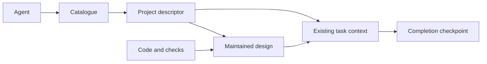

# Vault design

Status: maintained design with implemented core, independently tracked changes and scoped evidence. Updated: 13 October 2026.

Vault holds shared project documentation and task tools. Its catalogue, descriptors, consistency helper and ordinary guides implement the core; [CURRENT.md](../CURRENT.md) records observed state. Vault contains no packaged agent skills or local installer. Accepted file metadata support remains unimplemented.

Confirmed requirements:

- One central repository and checkout named Vault, accessible to agents across projects, with folder descriptions for finding context.
- Readable task context and progress for user audit, and ordinary writing guidance reflecting the user's preferences.
- Markdown with images and diagrams; useful task tools with no suitable home in another repository.
- Optional YAML file metadata, including webpage association and sync direction, parsed separately and removable without changing the body.
- Update appropriate existing documents by default. Create a document only when explicitly requested or when requested work or an agreed workflow needs one with no appropriate existing home.

The five reviewed issues are addressed below and in [AGENTS.md](../AGENTS.md). Design resolution or component installation does not establish untested runtime behaviour.

## Current implementation

Canonical descriptors at `projects/<project-id>/PROJECT.md` route to maintained documents. Vault's descriptor indexes this design, the research comparison and root current-state record; suitable existing documents keep their paths.

`scripts/docs_repo.py` derives its root from its own location; `--root PATH` supports fixtures and relocated checkouts. It safely loads YAML frontmatter with PyYAML, validates unique routing identities, generates deterministic `CATALOG.md`, finds candidate projects and checks supported local links, media and anchors. It is a bounded consistency checker, not a complete Markdown parser or proof of implementation correctness. Remote URLs and viewers require separate checks.

The helper recognises escaped opening brackets by backslash parity and masks inline code in link labels while preserving destinations containing literal backticks. It excludes multiline links, multiline code spans and indented code. Ambiguous `//host/path` destinations are rejected as possible local UNC paths.

Operating instructions live in `AGENTS.md`; ordinary writing and task-tool guides live under `projects/vault/guides/`. Agents receive Vault's location through their session or external configuration. Vault installs no skills or global settings. Filesystem access is separate: the external CLI integration test uses `--add-dir`, with no global permission override. Writer coordination remains cooperative.

Task-only utilities belong in their task's `tools/`, with source links and run instructions in its existing context. The [task tools guide](../projects/vault/guides/task-tools.md) defines ownership, commands, dependencies, effects, results and checks. This is a file convention, not a hosted execution service.

[The integration harness](../scripts/test_integration.py) and [retained fixtures](../tests/fixtures/integration/) replay bounded checks. Offline checks cover routing, relocation, saved design/history/recovery invariants, media source and a JSON-count tool. Optional checks run isolated Codex roles with ordinary instructions and guides, or render diagrams in a custom browser viewer. Results identify checked and unchecked scopes and source hashes. Historical input hashes and installation reports describe their original runs, not the revised harness.

## Change remove-skills

Decision: `accepted` on 12 October 2026, following the user's instruction that Vault should not have skills. Implementation: `implemented`. Verification: `passed` for local unit, catalogue/link and offline integration checks; live-agent and browser checks for this revision remain `not-checked`. [Task, plan and delivery checkpoint](../projects/vault/tasks/remove-skills/context.md).

Packaged skills and the local installer are removed. Their writing and task-tool references remain ordinary guides; catalogue discovery, document checks and the integration fixture need no skill installation. Global user configuration is unchanged.

This supersedes the historical setup's skill and installer components. The accepted file metadata description remains; general parsing/removal and webpage syncing are pending.

## Change setup-remediation

Historical delivery: 11 October 2026. Skill installation is superseded by [Change remove-skills](#change-remove-skills); these checks describe the earlier revision.

[Setup-remediation](../projects/vault/tasks/setup-remediation/context.md) was authorised on 11 October 2026 after review: address all six findings, repeat setup checks and commit. The user also authorised a private GitHub repository named `vault` for off-machine backup.

| Scope | Decision | Implementation | Verification |
| --- | --- | --- | --- |
| Relocated Python environment | accepted | implemented | passed: regenerated activation scripts and pip launchers resolve to Vault; PyYAML remains available. |
| Installer failure recovery | accepted | implemented | passed: 14 installer tests, including rollback after publication; the real installation passed twice. |
| Desktop project and current-state correction | accepted | implemented | passed: the user confirmed sidebar removal; the API list excludes `docs`, both chats use Vault and the empty former directory is removed. |
| Commit and private backup | accepted | implemented | passed: commit `7e5ffc3716c360e6e1d1641e0904418df056e5cd` is on private `origin/master`; remote and local hashes match. |
| Escaped Markdown and destination parsing | accepted | implemented | passed: 24 helper tests, one privileged file-symlink skip; integrated consistency check passed. |
| Durable integration fixtures and harness | accepted | implemented | passed within recorded scopes: retained fixtures, ten harness tests, offline/installed-file/browser checks, five live roles with a separate final audit, and clean-checkout replay. |

Root was the single writer of shared design, summaries and indexes. The [completion checkpoint](../projects/vault/tasks/setup-remediation/context.md#completion-checkpoint-setup-remediation) records ownership, revision, checks and limitations. Earlier checkpoints below retain their original accounts.

## Document maintenance rule

- Read the appropriate existing document, integrate new information and correct outdated claims throughout it. Keep status, evidence and links consistent; an appended correction cannot resolve conflicting maintained claims.
- Create a document only when explicitly requested or when requested work or an agreed workflow needs one without an appropriate existing home. Avoid dated replacements, numbered copies or supplements solely for updates. Add supporting assets when needed.
- Follow `AGENTS.md`. A distinct authorised task may need one context; messages, findings and revisions reuse it. Feature extensions reuse their maintained design.

## Recommended approach

Use ordinary files for discovery, task state and writing guidance. The diagram shows routing and evidence ownership; [CURRENT.md](../CURRENT.md) records completed integration checks. [Editable Mermaid source](assets/docs-workflow.mmd) matches the SVG fallback.




The approach draws on [OpenSpec's central store](https://github.com/Fission-AI/OpenSpec/blob/main/docs/stores-beta/user-guide.md), [Kiro's description-based selection](https://kiro.dev/docs/steering/) and [Memory Bank's context summaries](https://github.com/cline/cline/blob/main/docs/best-practices/memory-bank.mdx). Consider a service, semantic database, website or full specification framework only after a demonstrated need.

## Layout conventions

```text
vault/
  README.md                         Human introduction
  AGENTS.md                         Instructions for working inside this repo
  CATALOG.md                        Generated project descriptions and links
  projects/
    <project-id>/
      PROJECT.md                    Project description and document/task index
      current.md                    Project-level facts and links to feature facts
      tools/                        Shared project utilities, when justified
      features/                     Maintained feature documents, when needed
        <feature-id>.md             Current design and separately labelled changes
        assets/<feature-id>/        Feature images and diagram sources
      tasks/
        <task-id>/
          context.md                Current state and next action
          progress.md               Milestone history, when needed
          research.md               Sources and findings, when needed
          design.md                 Only for a separately needed/requested design
          assets/                   Images and editable diagram sources
          tools/                    Task-only scripts and utilities
          outputs/                  Regenerated results, ignored by default
      decisions/                    Significant lasting decisions, when needed
      guides/                       Maintained project guides, when needed
  scripts/                          Catalogue generation, consistency and fixture checks
```

These are defaults for content without an existing home. Keep and index suitable documents at their current paths, including this design. Create optional files and folders only for warranted content or an explicit request. A small task can use one `context.md`; larger work links to existing research and designs or creates distinct documents where needed. A project need not have a code repository.

## Maintained designs and task records

Use one maintained design home per documented feature: its suitable existing document, otherwise `features/<feature-id>.md`. Include a stable identifier, short description, current design and identified changes. A small project can use one project design.

| Document | Owns | Links to |
| --- | --- | --- |
| `PROJECT.md` | Discovery, scope and routing. Feature entries identify subject/path; task entries identify task/deliverable/context path. | Maintained designs, task contexts and project facts. |
| Maintained feature or project design | Detailed current design, feature evidence, proposed changes and material rationale. | Originating tasks, decisions, source and checks. |
| `current.md` | Project-level environment or integration facts and evidence. | Canonical feature current-design sections. |
| Task `context.md` | Deliverable, scope, goal, progress, next action, tool instructions and completion checkpoints. | Maintained design, canonical tools, results and stable change identifiers. |
| Existing decision records | Significant decision context, rationale and supersession history. | Affected designs and tasks. |

Keep detailed facts and status in their owning documents. Use a task design only when separately requested or needed without a suitable home, such as a cross-project proposal. It then owns the detail; feature documents link to it. After checked implementation, integrate current facts into maintained feature documents and preserve proposal history in the task checkpoint.

## Folder descriptions and catalogue

`PROJECT.md` is each project's canonical descriptor. Frontmatter holds a stable name and short description of the context and when to consult it; aliases and repository identities are optional routing aids. Its body owns the overview, scope, constraints and document links.

Illustrative Vault descriptor:

```yaml
---
name: vault
description: >-
  Shared project documentation, discovery, task context, writing conventions,
  and task-tool storage. Consult when building or using Vault's document conventions.
aliases: [agent-docs, shared-docs, docs-repo]
repositories: []
---
```

Derive folder paths and entry links from descriptor locations; avoid a second maintained path field. Use repository URLs or stable identities where available. Keep machine-specific checkout paths in local configuration.

The helper generates committed `CATALOG.md` with each project's name, description, routing aids and relative descriptor link. Edit descriptions once, in frontmatter. Regenerate after project additions, removals, renames or routing-metadata changes; ordinary task updates need no regeneration.

Read the catalogue and confirm the subject through a matching descriptor and requested scope. Repository identity aids selection; descriptions support requests spanning repositories. For multiple matches, read the descriptors or clarify before writing. Resume the matching task, not simply the newest. Descriptors have no automatic loading semantics.

## Change file-metadata

Decision: `accepted` on 12 October 2026, following the user's request to describe optional file metadata. Implementation: `not-started`. Verification: `not-checked`. [Design task and delivery checkpoint](../projects/vault/tasks/file-metadata/context.md).

A Markdown file may start with a YAML mapping between two `---` delimiter lines. It describes the file and stays with its content. Project descriptors require frontmatter; other documents may omit it, leaving the entire file as body.

Example webpage association and intended sync direction:

```yaml
---
sync:
  url: https://example.com/my-page
  direction: vault-to-web
---
```

- Read the leading block separately with a safe YAML parser.
- Remove only that block and its delimiters; preserve all remaining content and line endings exactly.
- Treat delimiters and YAML examples later in the body as ordinary content.
- Report malformed YAML or an unclosed leading block; never silently remove content.

The fields record intent. Automatic webpage syncing needs separate implementation. The helper handles project descriptors only; general file metadata reading/removal is neither implemented nor checked.

## Proposed behaviour and present state

Keep observed current design separate from identified changes. Record gaps and contradictory observations even when reality differs from an accepted decision. Descriptions and proposals do not establish working capabilities.

| Record | Establishes |
| --- | --- |
| Confirmed requirement | The user's desired outcome or constraint. |
| Proposed design | Possible future behaviour under consideration. |
| Accepted decision | Chosen direction and its source; implementation may be pending. |
| Implemented, unverified work | Changed files or code, with outstanding checks. |
| Verified current state | Observed behaviour within the recorded revision, environment and scope. |

Use no blanket acceptance or implementation status for a document containing changes at different stages. Give each change a stable identifier, originating task and independent states:

| State | Values | Record |
| --- | --- | --- |
| Decision | `proposed`, `accepted`, `rejected`, `superseded` | Source and rationale of acceptance or supersession. |
| Implementation | `not-started`, `partial`, `implemented`, `not-applicable` | Delivered work. `not-applicable` is only for a change requiring no implementation. |
| Verification | `not-checked`, `passed`, `failed`, `needs-recheck` | Relevant checks, evidence and scope. |

Acceptance changes decision state only. A design task can complete while its change stays `not-started` / `not-checked`.

Record implementation and verification per required scope when results differ. Overall implementation stays `partial` while requested work is missing. Overall verification is `passed` only when relevant checks cover the full declared scope at the stated revision and environment. Otherwise identify failed, stale or unchecked scopes and preserve subset results. Never narrow scope to obtain a pass; record user-authorised scope changes.

Illustrative filters change, not a real search implementation in Vault:

| Required scope | Implementation | Verification | Evidence |
| --- | --- | --- | --- |
| Category filtering | `implemented` | `passed` | Subset results, source revision, environment and date. |
| Date filtering | `not-started` | `not-checked` | No implementation or check evidence. |
| Whole requested change | `partial` | `not-checked` for the full scope | Category checks do not establish date filtering. |

Support current claims with files, checks or observations, date, revision and applicable scope, such as workspace, installed skill or agent environment. Local catalogue checks do not establish external discovery.

Integrate verified changes into the owning current-design section and affected summaries or guides. Retain each change's identifier, substantive delta, rationale, outcome and checkpoint. Revise active proposals in place; preserve existing superseded decisions and link replacements. Recheck claims affected by source or environment changes, or mark verification `needs-recheck`.

## Agent discovery and access

```text
Vault location supplied through the session or external agent configuration
  -> CATALOG.md
  -> Relevant PROJECT.md
  -> Maintained design and matching task context
  -> Detailed documents needed for the work
```

`AGENTS.md` owns workflow; indexes route to existing context and ordinary guides supply writing/tool instructions. Supply Vault's location and grant the session appropriate filesystem access when working elsewhere. Vault provides no automatic cross-project discovery or skill installation service; instructions alone grant no access.

## Task context and audit

Use one stable task directory and context for each distinct authorised task under this workflow. Record identifier, requested deliverable, scope, goal, status, last update, relevant source repositories/revision, maintained design paths and change IDs. Include progress, unresolved assumptions, constraints, evidence and next action. A new message or session does not create a new task.

Assess completion against the requested deliverable:

| Task | Completion requires |
| --- | --- |
| Design | Coherent, reviewable design with constraints, trade-offs, status and open issues. Implementation is not required. |
| Research | Delivery of the requested research scope. |
| Implementation | Delivered behaviour and relevant checks. |

Record actual outcomes and evidence. Implement only when requested or already authorised; design acceptance alone is insufficient.

Update context at scope changes, significant findings, phase completion and handoffs. Keep dated milestones when useful for audit, without reproducing the conversation or every tool call. On resumption, verify source facts relevant to the next action; timestamps alone do not establish freshness. Link completion claims to checks, files, commits or appropriate evidence.

- Resume unfinished work in its existing context.
- Reopen original completed scope by preserving its checkpoint and appending an amendment.
- Track a new extension as a distinct linked task reusing the maintained design; do not rewrite the earlier delivery to include it.
- Keep completed tasks at their existing paths. Correct historical errors with dated amendments retaining the original account.

A dated completion checkpoint in the existing context preserves delivered scope, check results and limitations, material decisions/rationale and relevant requirements/contracts. Link the maintained design and stable change ID. Before Git, retain the historical facts in prose: mutable links or revision labels cannot recover overwritten content. This preserves the design basis, not a full document copy. With Git, also record exact docs commits and paths for the design used, plus implementation commits where applicable; branch names are mutable. Retain earlier prose checkpoints because later Git cannot recover prior lost content.

Promote lasting facts into their maintained owners and link task evidence. Preserve significant decisions in existing records or dated sections. Git and milestones support audit; implementation claims still require scoped checks.

## Coordinating shared edits

Before overlapping edits to designs, summaries, indexes, decisions or the catalogue, one coordinator assigns a single writer per shared file and records ownership in existing context and agent instructions. Separate task IDs do not exempt shared files; agents cannot independently claim the same document.

Contributors use their task records or send evidence to the writer. The writer rereads the document, preserves unrelated edits, reconciles proposals and integrates contributions. Explicit handoffs name the new writer and pending contributions. Until ownership is resolved, keep contributions in context.

This is cooperation, not an automatic filesystem lock. The pilot must exercise two agents sharing a feature as well as agents using separate task records.

## Writing guidance and media

`AGENTS.md` owns maintenance, recovery and writer coordination. The ordinary [writing style guide](../projects/vault/guides/markdown-style.md) records simple, formal English, concise wording, no unnecessary repetition or stock AI phrasing, and useful bullets/tables. The [task tools guide](../projects/vault/guides/task-tools.md) owns utility guidance. Update these documents in place.

Use relative media links. Retain existing locations; for new content under the suggested layout, use `features/assets/<feature-id>/` for feature media and task `assets/` for task-only media. Link reusable assets instead of copying them. Keep editable diagram sources beside rendered assets. Use Mermaid where supported, with SVG or PNG alternatives when needed. Alt text describes content; nearby prose explains significance. Check the intended viewer. [Markdown and media links](https://docs.github.com/en/get-started/writing-on-github/getting-started-with-writing-and-formatting-on-github/basic-writing-and-formatting-syntax), [Mermaid support](https://docs.github.com/en/get-started/writing-on-github/working-with-advanced-formatting/creating-diagrams).

For lasting decisions, use short records with context, status, decision and consequences. Preserve superseded records and link replacements. [ADR precedent](https://cognitect.com/blog/2011/11/15/documenting-architecture-decisions).

## Implementation and remaining work

Retained components are the descriptor, catalogue, helper, guides and editable diagram/SVG fallback; skills and installer are removed. Vault is the first real indexed project. Earlier rules-only and installed setup checks remain historical; the removal task records revised-repository checks.

Refine writing guidance from real user edits and index new projects as needed. Other hosts and viewers need their own access/rendering checks. Introduce coordination enforcement only if demonstrated need warrants it.

Pilot acceptance checks:

- Fresh agents select the correct project from description and repository identity without reading unrelated projects; supplied location and session access enable catalogue/index discovery.
- Fresh sessions recover matching task state, next action and checked/unchecked scopes.
- Readers distinguish current behaviour, accepted decisions and proposals; unimplemented acceptance is never presented as working capability.
- Design-only tasks can complete before implementation; acceptance does not trigger implementation.
- Extensions update indexed maintained designs without competing task designs by default.
- Relative document/media links survive cloning elsewhere; diagrams render in the chosen viewer.
- Agents preserve each other's task work and coordinate one writer for shared feature documents.
- Completed tasks retain delivery and design basis after maintained designs change; exact historical retrieval is checked when Git exists.
- Project description changes regenerate a consistent catalogue.
- Produced documents follow agreed style and expose proposal/implementation status.
- New findings and requirements update existing documents, correct stale claims throughout and create no duplicates.
- Follow-ups and resumptions reuse context; partial checks establish only their stated subset.

## Worked example: extending search

Illustration only: assume an existing document records checked keyword search. Keep that design at its existing path.

| Event | Documentation action | Task outcome | Filter-change state |
| --- | --- | --- | --- |
| User requests filter design. | Check existing design/code; add an identified proposal with behaviour, interfaces, trade-offs and open issues. Use one design context. | Complete on design delivery; retain scope/design-basis checkpoint. | `proposed` / `not-started` / `not-checked`. |
| User accepts design. | Record acceptance source; keep keyword behaviour separate from intended filters. | Design task stays complete. | `accepted` / `not-started` / `not-checked`. |
| User requests implementation. | Create the distinct implementation context, linked to design task and same change ID; reuse maintained design. | In progress until requested scope and checks are satisfied. | Implementation becomes `partial` or `implemented`; verification follows actual checks. |
| Only category filtering is implemented and checked. | Record category/date results separately; preserve pending work. | Incomplete while requested filters remain missing. | `accepted` / `partial` / `not-checked` overall; category `passed`. |
| Full requested filters are implemented and checked. | Integrate current behaviour; retain delta/rationale and implementation checkpoint/revisions. | Complete; earlier checkpoint still describes design-only delivery. | `accepted` / `implemented` / `passed` within stated scope/revision. |

Design follow-ups reuse its task. Concurrent ranking design requires one coordinated search-document writer; agents contribute through their task records. Project summaries link to maintained search facts.

## Design review resolutions

Historical review: 11 October 2026. The user requested resolution of five issues; design definitions and operating rules address them. Checkpoints below record representative local and fresh external Codex exercises. Skill/installation references describe the earlier setup, superseded by [Change remove-skills](#change-remove-skills).

| Reviewed issue | Resolution |
| --- | --- |
| No maintained feature-design home. | One indexed existing feature/project design; otherwise `features/<feature-id>.md`. Task designs are optional distinct artifacts. |
| Mixed current/proposed behaviour. | Separate current design and identified changes; independent decision, implementation and verification with scoped evidence and one fact owner. |
| Mutable links obscure history. | Context checkpoints preserve contracts; Git adds exact commit/path references. Mutable links or labels are insufficient. |
| Concurrent tasks share documents. | Coordinator assigns one writer; contributions use context/messages. No automatic lock. |
| Completion mismatches request. | Deliverables govern completion; design can finish before implementation and acceptance alone authorises no code changes. |

[OpenSpec's separation of maintained domain specs and change records](https://github.com/Fission-AI/OpenSpec/blob/main/docs/getting-started.md) informed the design, adapted to in-place document maintenance. [The ADR convention](https://cognitect.com/blog/2011/11/15/documenting-architecture-decisions) supports preserving superseded decisions.

The isolated pilot preceded core implementation. The later 11 October setup added catalogue, skills, helper and user pointer, then checked discovery, external access, installed skills, shared edits and media within recorded environments. Skills and installer have since been removed; use [CURRENT.md](../CURRENT.md) for observed current state. Neither pilot establishes automatic behaviour in arbitrary viewers or sessions. Refine optional forms from real work without empty scaffolding; further integration follows observed gaps.

## Completion checkpoint: docs-workflow-refinements

Recorded: 11 October 2026. Work identifier: `docs-workflow-refinements`.

Requested deliverable: address the five design-review issues. This was documentation and workflow design work. It did not include building the catalogue, installing skills, or configuring cross-project access.

Delivered: this maintained design and the existing local `AGENTS.md`, README, and current-state record were revised. The design basis at this checkpoint is:

- An existing appropriate feature or project design remains authoritative. New feature designs default to `features/<feature-id>.md` only when needed. Extensions reuse that document, and task contexts link to it.
- Current design and identified changes are separate sections. Decision, implementation, and verification are independent, with scoped results when a change is partial. Project current-state records link to detailed feature facts rather than copying them.
- Task completion follows the requested deliverable. A completed design task can leave implementation and verification pending. Follow-ups reuse task context; a distinct extension uses a new task record under the configured workflow and preserves earlier completion history.
- Completion checkpoints retain delivered scope, checks, decisions, rationale, and relevant requirements or contracts in prose. Exact commit-and-path references are added when Git is available. A link or revision label alone does not preserve overwritten content.
- A coordinator assigns one writer before overlapping edits to shared maintained documents. Other agents contribute through task context or messages. This relies on cooperation and does not implement an automatic lock.

Checks: local document links and Markdown code-fence balance were checked. An independent agent applied the written workflow to five hypothetical cases: design and acceptance, concurrent feature work, pre-Git historical references, partial filter implementation, and an explicitly requested separate design document. The cases produced consistent outcomes. Its two follow-up findings were addressed through explicit scoped-state notation and this historical checkpoint.

Limits: no code feature, catalogue, skill, shared-file locking mechanism, or cross-project integration was implemented or exercised. No Git revision is available. This checkpoint preserves the relevant design basis, not the exact earlier contents of every document.

The checkpoint is kept in this existing design while task-record infrastructure is unimplemented. It is a historical account of this revision. Preserve it when the maintained design changes and append dated corrections or amendments where needed.

## Completion checkpoint: docs-commit-and-workflow-pilot

Recorded: 11 October 2026. Work identifier: `docs-commit-and-workflow-pilot`.

Requested deliverable: commit the existing documentation and test the current setup. Delivered: initial documentation commit `5f59540882edaf238f7a0f1e1c58cb583bf78205`, followed by actual agent edits and a fresh-agent recovery test in an isolated clone. This exercised the local rules; it did not build the proposed catalogue, skills, or cross-project integration.

The synthetic project had one maintained search feature, a project descriptor and index, and a completed keyword-search task. Its seeded code initially supported keyword search only. The coordinator assigned one documentation writer; reviewers and the recovery agent had read-only roles. Fixture files and code were kept outside this repository.

| Exercise | Observed result and checks |
| --- | --- |
| Design an existing feature extension. | The agent updated the maintained search document, created one context for the distinct design scope, and added one index entry. The design task completed while its change stayed `proposed` / `not-started` / `not-checked`. Code and the original task remained unchanged. No competing feature or task design appeared. |
| Accept the design in a follow-up. | The same documents were updated. The design task stayed complete; the change became `accepted` / `not-started` / `not-checked`. The delivered checkpoint text and source remained unchanged. Exact delivery commit/path references were added separately. |
| Record a checked implementation subset. | The coordinator implemented category filtering only in the fixture. `python fixture_checks.py` passed three keyword assertions and `python category_checks.py` passed nine category/default assertions on Windows with Python 3.14.3. The agent recorded category results as `implemented` / `passed`, dates as `not-started` / `not-checked`, and the full change as `accepted` / `partial` / `not-checked`. The full implementation task remained in progress; its requested scope was not narrowed. |
| Recover work in a fresh agent. | With no earlier conversation supplied, a read-only agent recovered the full requested scope, checked category subset, pending dates and combined interface, next checks, existing implementation context, and maintained feature. It found no contradiction blocking resumption and no need for another task or design file. The clone path and task subject were supplied explicitly. |
| Retrieve historical design after current facts changed. | `git show` recovered both the earlier maintained design and its task context at the exact delivery commit. Original keyword history and the completed design checkpoint stayed unchanged as implementation progress was recorded. The earlier snapshot describes design-only delivery, not later implementation. |

Fixture revision evidence, all in the temporary clone rather than this repository: baseline `65db34aebc60371f62347cba744822f34918ebb9`; design delivery `db1913d1b6978d5d9a7ee528906e7414485e53ec`; accepted design `0d3b3ad942e6273203967a5749743431cb068d44`; category source and checks `9b99283be47452b48e1e1f3074b2c6bcef38179d`; partial-progress documents `c2d80ac55229137f76c1d2b6fcc1b8270e94abb5`. The maintained feature path was `projects/search/features/search.md`; task contexts were under `projects/search/tasks/`. Local diagnostic checkout: `C:/Users/james/AppData/Local/Temp/agent-docs-pilot-b887a88e2ecb4eebacacd174a46344c4`. That temporary location is evidence for this run, not portable project configuration or durable storage.

Checks on the committed documentation baseline: five Markdown files, fourteen local links including anchors, balanced code fences, and Git whitespace checks passed. Pilot assertions checked document counts, change states, original source hashes, unchanged historical records, and exact Git retrieval. This is observed cooperation in representative cases, not an enforcement guarantee.

Setup audit: the real repository has no `CATALOG.md`, `projects/`, `.agents/skills/`, or `scripts/`. The custom documentation skills were absent from both inspected user skill directories. The global `.codex/AGENTS.md` was empty, and targeted configuration searches found no central-docs pointer. Those missing components prevent an end-to-end discovery and installed-skill test today.

Remaining verification: automatic project selection, filesystem access in an independently started external session, catalogue generation, installed skills, concurrent shared edits and handoff, agreed prose style, and media rendering/portability. The fixture pilot does not establish these capabilities. The next implementation scope remains the catalogue and skills, followed by their integration pilot.

## Completion checkpoint: docs-full-setup-validation

Recorded: 11 October 2026. Work identifier: `docs-full-setup-validation`.

Requested deliverable: after committing the initial documents and exercising their rules, the user requested testing all of the setup. This authorised implementing the missing catalogue, skills, local installation, and checks, then exercising discovery and documentation work end to end. Delivered: the core implementation, local user installation, automated checks, and actual agent/media pilots below. The earlier checkpoints retain the state and scope of their original deliveries.

The implementation basis at delivery is:

- Canonical `projects/<project-id>/PROJECT.md` frontmatter owns names, descriptions, aliases, and repository identities. The helper generates the catalogue and returns matching candidates; agents confirm scope through descriptors and task context. This real repo currently indexes only `agent-docs` and reuses its existing root and planning documents.
- Extensions revise the maintained feature or project design. A distinct authorised scope can need one task context; follow-ups reuse it. Current facts, proposals, decision state, implementation state, and scoped verification remain separate. Design delivery or acceptance alone does not authorise implementation.
- Task checkpoints retain material contracts and evidence. A coordinator assigns one shared-document writer before overlapping work and explicitly coordinates handoffs. These are cooperation rules, not filesystem locks.
- The two canonical skills are linked into user scope on this Windows machine. The managed global instruction block and local `docs_root` expose discovery. Session filesystem permissions remain independent; the external pilot used an explicit `--add-dir` grant.
- Documents use relative media links, editable Mermaid source, and an SVG fallback. The consistency helper has a documented bounded Markdown/HTML syntax scope. Existing Markdown remains readable when helper dependencies are absent. The writing reference is provisional pending user feedback.

| Exercise | Observed result and scope |
| --- | --- |
| Automated helper and installer checks | `python -m unittest discover -s tests -v` ran 23 tests: 22 passed, one skipped because Windows file-symlink creation requires a privilege unavailable to this process. Coverage includes safe and duplicate YAML handling, recursive aliases, metadata/catalogue updates, candidate ambiguity and repository filtering, supported links/anchors/media, relocation, and installer idempotence, unrelated-content preservation, and conflict refusal. A separate directory-junction fixture confirmed the helper rejects a project that resolves outside the repo. |
| Skill validation and real installation | Both manifests passed the Skill Creator `quick_validate.py`. The installer configured `C:/Users/james/.agents/agent-docs.json`, junctions under `C:/Users/james/.agents/skills/`, and the managed block in `C:/Users/james/.codex/AGENTS.md`. Inspection confirmed the two junctions resolve to the canonical tracked skill directories. No tracked skill contains this machine's absolute root. |
| Fresh external bootstrap | From an unrelated temporary working directory, Codex's prompt-input inspection exposed the managed global instructions and exactly one metadata entry for each custom skill. This checked actual skill descriptions, not just mentions in the global pointer. |
| External design-only extension | A separately started Codex session received a natural Delivery Board design request without a docs path or expected output path. It read both installed skills and the catalogue, found the synthetic project, updated its existing dashboard feature, and created only one context for the distinct filter-design task. The task completed while change `dashboard-filters` remained `proposed` / `not-started` / `not-checked`. Source-free fixture assumptions stayed labelled as assumptions; the original delivery checkpoint hash stayed unchanged. |
| Independent external recovery | A second fresh session received only the project/task subject and a read-only resumption request. It read the context skill and catalogue, found the same completed design task, distinguished delivery from implementation/runtime verification, recovered the unresolved date-source question, and identified review as the next action. It made no edits or new task. |
| Parallel contributions and explicit writer handoff | In the isolated search clone, `/root/workflow_check` was assigned sole writer of the maintained feature and index; `/root/design_review` wrote its ranking contribution in its own context and sent it for integration. The writer integrated both proposals. Root ended that assignment and explicitly handed the shared documents to the ranking contributor. Its follow-up refined title-only ranking, excluded category/date weighting, retained stable ties and default-off behaviour, and reused the same proposal and task. Exactly two new task contexts and no competing task designs resulted. Both changes stayed proposed and unimplemented. Affected links/anchors/fences and Git whitespace checks passed. Root confirmed unchanged source, all earlier task histories, the original feature account, and the completed highlight context. |
| Markdown, diagrams, and relocation | A snapshot of 20 then-current files was hash-checked and moved before rendering. A custom local viewer using marked 17.0.5, Playwright 1.62.1, Chrome 155.0.8059.39, and Mermaid 12.1.0 rendered seven nodes and seven edges. The Mermaid fence matched the editable `.mmd`; the SVG loaded at 1100 by 330 pixels. Relative local links returned HTTP 200, the relocated helper check passed, and screenshots were inspected for legibility and clipping. This proves this Chrome viewer's result, not Codex or GitHub rendering. |

Test environment: Windows, PowerShell, Python 3.14.3 with PyYAML 6.0.3 in the repo's ignored `.venv`; fresh external runs used the installed app's Codex CLI `0.162.0-alpha.17.2` with its configured default model. Both external sessions exited successfully. Ephemeral transcript/subagent-hook warnings appeared in CLI stderr; these results cover the completed primary sessions and inspected documents, not those hooks.

Preservation evidence: Delivery Board's original checkpoint retained SHA-256 `9da59037637ec1148c08da78013dcd04be3cf2157bf2155871dc29d35d54c270`. In the shared-edit clone, the completed highlight context retained `f559f283906b8e68200a5287bd91501ae342f7950551c4735c05e6a24a3594b4` across handoff; application source retained `18a2d08c0b50110ff4a991f566697d295baf7fc7a9d360ea6071c1ac9337bde8`. The final synthetic feature hash was `be7f69c08e91e790f0274063b25cc6ad86aa4727f47ceeeee2e8e2000d7287b7`. Original keyword/filter history hashes and the unchanged baseline feature prefix were checked against the earlier fixture revision `c2d80ac55229137f76c1d2b6fcc1b8270e94abb5` and its recorded hashes.

Local diagnostic locations for this run, not durable or portable configuration:

- External bootstrap, design/recovery traces, copied four-file Delivery Board output, and its hash manifest: `C:/Users/james/AppData/Local/Temp/docs-outside-8ec270e255d24e649bde332a4f462c5f`.
- Shared-edit clone and `shared-edit-result.json`: `C:/Users/james/AppData/Local/Temp/agent-docs-pilot-b887a88e2ecb4eebacacd174a46344c4`.
- Relocation manifest, `result.json`, moved snapshot, and inspected screenshots: `C:/Users/james/AppData/Local/Temp/agent-docs-media-f0c13a508f5541509ba3f3f390a928e6`.

The temporary Delivery Board project was copied and hash-checked before removal from the real repo. The catalogue was regenerated to contain only the real documentation project. No synthetic application or pilot task is committed here. The implementation and this evidence are delivered together as the next local Git milestone after `0d857ea`; its exact revision is available in Git history. Existing research and historical checkpoint prose are retained.

Amendment, 11 October 2026, setup remediation: the implementation and this checkpoint were committed at `1c58e473971eeccf9caa48daa1b597d1d7017dd6`, including `planning/docs-repo-design.md`, `scripts/docs_repo.py`, `scripts/install-local.ps1` and the canonical skills. The remediation now retains the four historical Delivery Board outputs and a resettable synthetic fixture under `tests/fixtures/integration/`, with a hash manifest and replay harness. This later evidence retention does not change what was committed or verified in the original delivery.

Limits and next action: the observed core setup passes within these environments. Cross-platform installation, other agent/session permission configurations, arbitrary viewers, and external URLs were not verified. Writer coordination remains cooperative. User approval of the final prose style remains open; refine the existing style reference from a real document review rather than claiming that preference is already agreed. Add real project descriptors when needed and recheck claims affected by future source or environment changes.

## Completion checkpoint: writing-style-preferences

Recorded: 11 October 2026, follow-up after setup commit `1c58e47`.

Requested deliverable: a writing style document specifying concise, simple but formal English, no stock AI phrasing or unnecessary repetition, and bullets and tables where needed. Delivered: the existing style reference was revised in place, with practical rules and three short editing examples. The writing skill and repo instructions apply it; the README and project index make it accessible. Current-state summaries now distinguish these specified preferences from the earlier provisional defaults.

Checks: supported local document links and catalogue consistency passed; the revised skill passed the Skill Creator validator, and Git whitespace checks passed. Reading through the installed user-skill junction returned the updated guide. A read-only review informed the rules for precision, consistent terms, useful formatting, and removing filler without losing evidence. The earlier completion checkpoints retain their original delivery accounts.

Scope: this follow-up records and integrates writing instructions. It does not establish automatic style compliance or rerun the external agent pilot against the revised preferences. Further user feedback updates the same guide.

## Completion checkpoint: vault-rename-and-task-tools

Recorded: 11 October 2026. Status: documentation, tool support, and checkout-content relocation delivered; desktop project and active chat path updates, and empty old directory cleanup pending.

Requested deliverable: rename the project to Vault, move the checkout from `docs` to `vault`, and support task scripts with no suitable home in another repo. The user explicitly confirmed the folder move. Existing writing-style changes are retained.

Delivered conventions: Vault's descriptor is `projects/vault/PROJECT.md`; `agent-docs`, `shared-docs`, and `docs-repo` remain discovery aliases. The existing design, current-state record, instructions, and skills were updated. A focused task-tools guide was added because that workflow had no existing guide. Task-only utilities live under the owning task's `tools/`; its existing context owns source links, invocation and working directory, dependencies, inputs/outputs, effects, and actual check results. Application tools stay in their owning repo. Shared utilities can be linked and later promoted when shared ownership is justified. Regenerated task outputs are ignored by default. No separate tool catalogue, execution service, or empty task/tool scaffolding was created.

Checks before the live move: the full suite ran 29 tests, with 28 passing and one skipped for unavailable Windows file-symlink privilege. Ten installer tests include explicit relocation, unchanged canonical sources/settings, conflict refusal before mutation, dangling links, Unicode through Windows PowerShell, and refusal of unsupported JSON depth. Both skill manifests validate. Local links and catalogue checks pass; new and former project names both route to the same descriptor.

The isolated task-tool fixture at `C:/Users/james/AppData/Local/Temp/vault-task-tools-pilot-w02lu2tz` saved and executed a standard-library JSON item-count script, refined it at the same path, and reran the literal command from its context. Default mode counted three items before and after refinement; active-only mode counted two. The input remained unchanged and the earlier phase checkpoint was preserved with a dated command clarification. The helper accepted the linked script and JSON input/output paths. This checks the three-item fixture and its two modes, not arbitrary scripts or production data.

Migration outcome: all 1,032 checkout files, including `.git`, the environment, and pending writing-style changes, were moved to `C:/Users/james/Documents/repos/vault` with unchanged SHA-256 hashes. Windows held the original root open, so contents were moved with verified paths and the remaining empty child directories removed without recursive deletion. The old `docs` root is empty but still held open. The real user pointer, both skill junctions, and managed startup block now use Vault. Structural checks, catalogue consistency, and discovery through the new name and former alias passed from the moved checkout.

The installed CLI's supported experimental `project/update` changed the existing saved protocol project to Vault at the new root; a separate read verified it. The active desktop project list still reports its legacy docs entry, and this chat's stored cwd remains the old path. A fresh client could not update unloaded thread settings; loading the same chat was refused because it already has an active writer. No chat was interrupted or recreated, and no permission profile was changed. The desktop stores a separate legacy project entry still containing the former name and root, so a restart alone is not established to correct it. Updating that desktop entry and the active chat path, and deleting the empty old root, remain pending; this checkpoint does not claim that the active app moved. Migration diagnostics and the file-hash manifest are local temporary evidence at `C:/Users/james/AppData/Local/Temp/vault-relocation-30e31dd951904e3281a3eece419bb5b5`.

The configuration filename `agent-docs.json`, key `docs_root`, skill names, and managed block markers stay stable for compatibility. The installer uses an explicit matching `-PreviousDocsRoot`; it removes only preflighted directory links without traversing their canonical source. Filesystem permissions remain session-specific. Earlier checkpoints preserve the names, paths, and scope of their original deliveries.

Amendment, 11 October 2026, setup remediation: this current chat already runs from Vault. The original setup chat's saved folder has now been corrected through the supported local protocol, with its archive state restored and no turn started. The verified empty former directory has been removed, and the Python activation scripts and pip launchers have been regenerated at the new path. After the user confirmed removal of the obsolete desktop entry, the live API also returned Vault without `docs`. The [remediation task](../projects/vault/tasks/setup-remediation/context.md) records the later checks without rewriting this earlier delivery account.
